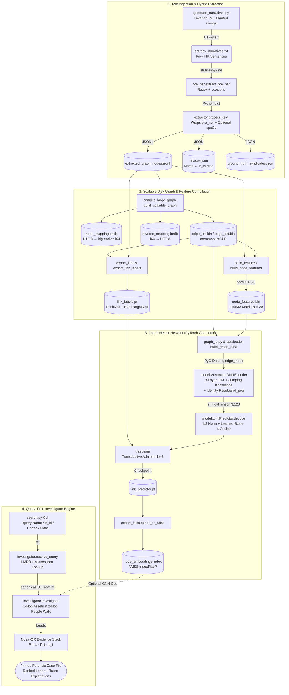
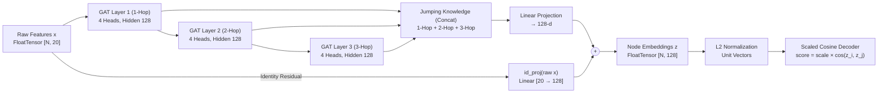

# 🦇 GOTHAM: Graph-Based Criminal Intelligence & Link-Prediction Engine

[](https://www.python.org/)
[](https://pytorch-geometric.readthedocs.io/)
[](https://github.com/facebookresearch/faiss)
[](https://lmdb.readthedocs.io/)
[](https://spacy.io/)

**GOTHAM** is an end-to-end criminal intelligence, entity resolution, and graph link-prediction engine engineered to transform unstructured First Information Reports (FIRs) into actionable investigative leads. 

Rather than treating crime records as isolated text documents or performing simple crime-type classification, GOTHAM compiles millions of unstructured narratives into a memory-mapped heterogeneous entity graph. It combines **Hybrid NLP + Regex extraction**, **Disjoint Set Union (DSU) entity resolution**, a **3-Layer Graph Attention Network (GAT)** with **Jumping Knowledge & Identity Residuals**, and a probabilistic **Noisy-OR Evidence Stack** to uncover hidden criminal syndicates across jurisdictions while suppressing false-positive "hub" coincidences (such as two unrelated individuals charged under the same legal statute or arrested at a crowded landmark).

---

## 📑 Table of Contents
1. [Problem Statement & Operational Motivation](#sec-1)
2. [What Makes GOTHAM Unique](#sec-2)
3. [End-to-End System Architecture](#sec-3)
4. [Stage-by-Stage Technical Deep Dive](#sec-4)
   - [Stage 1: Synthetic Entropy & Narrative Generation](#stage-1-synthetic-entropy--narrative-generation)
   - [Stage 2: Memory-Safe Hybrid Extraction (Pre-NER + spaCy)](#stage-2-memory-safe-hybrid-extraction-pre-ner--spacy)
   - [Stage 3: Disk-Backed Scalable Graph Compilation (LMDB + Memmap)](#stage-3-disk-backed-scalable-graph-compilation-lmdb--memmap)
   - [Stage 4: 20-Dimensional Node Feature Engineering](#stage-4-20-dimensional-node-feature-engineering)
   - [Stage 5: Hard-Negative Mining & Link Label Export](#stage-5-hard-negative-mining--link-label-export)
   - [Stage 6: Deep Graph Learning (3-Layer GAT + Jumping Knowledge)](#stage-6-deep-graph-learning-3-layer-gat--jumping-knowledge)
   - [Stage 7: Query-Time Investigator & Noisy-OR Evidence Stack](#stage-7-query-time-investigator--noisy-or-evidence-stack)
5. [Engineering Post-Mortem: Solving the Person-Sameness Collapse](#sec-5)
6. [Side Tools & Forensic Utilities](#sec-6)
7. [Complete Function & Type Signature Reference](#sec-7)
8. [Feasibility, Risks & Mitigation Matrix](#sec-8)
9. [Quickstart & CLI Usage](#sec-9)

---

<a id="sec-1"></a>
## 🚨 1. Problem Statement & Operational Motivation

Law enforcement agencies process thousands of unstructured FIRs daily. Traditional record management systems suffer from five critical blind spots:
* **Lack of Cross-FIR Link Analysis:** Shared assets (burner phones, stolen license plates, weapon serial numbers) appearing across different police stations remain disconnected in text blobs.
* **Repeated Offender & Alias Fragmentation:** Offenders use nicknames and aliases (e.g., `"Ramesh"` vs. `"Chotu"`), or share common Indian names with innocent citizens, causing naive name-matching databases to either fragment identities or falsely merge distinct individuals.
* **No Unified Criminal Intelligence View:** Frontline officers lack an instant multi-hop view of how a suspect's assets connect to wider syndicates.
* **Hidden Criminal Networks Remain Undetected:** Organized syndicates operate across multiple jurisdictions; individual FIRs only capture low-level incidents, masking the 2-hop and 3-hop ring structure.
* **Hub Noise in Naive Graph Queries:** Connecting every person who shares a common legal statute (e.g., `BNS 143`) or a busy landmark (`Sector-N`, `NH-N Junction`) explodes the graph with millions of meaningless edges.

---

<a id="sec-2"></a>
## 💡 2. What Makes GOTHAM Unique

1. **Dual-Engine Extraction (Regex + Lexicon Pre-NER + Optional spaCy):** High-speed deterministic regex and domain lexicons extract Indian phone numbers, license plates, weapon serials, and BNS/IPC/NDPS/Arms Act sections without requiring heavy NLP models in the critical loop, while optional spaCy NER enriches unstructured entity mentions.
2. **Zero-RAM-Bottleneck Graph Storage:** Instead of holding massive Python dictionaries or NetworkX objects in RAM, GOTHAM streams JSONL line-by-line into **LMDB** key-value stores (`node_mapping.lmdb`, `reverse_mapping.lmdb`) and contiguous binary **`int64` memory-mapped arrays** (`edge_src.bin`, `edge_dst.bin`).
3. **Over-Smoothing-Proof GAT Architecture:** Combines 3-layer multi-head Graph Attention (`GATConv`), **Jumping Knowledge (JK)** across 1-hop to 3-hop neighborhoods, and an explicit **Identity Residual (`id_proj(raw x)`)** with SHA-hashed identity features so message passing never collapses distinct people into identical vectors.
4. **Investigator Engine Over Raw Similarity Dumps:** Querying a suspect does not just dump raw cosine similarities. GOTHAM walks 1-hop assets and 2-hop associates, combining trace weights through a probabilistic **Noisy-OR Evidence Stack** that assigns `0.0` weight to crowded statutes/landmarks and provides human-readable audit trails for every lead.

---

<a id="sec-3"></a>
## 🏗️ 3. End-to-End System Architecture



---

<a id="sec-4"></a>
## 🔬 4. Stage-by-Stage Technical Deep Dive

### Stage 1: Synthetic Entropy & Narrative Generation
* **Module:** `generate_narratives.py` (`build_noise` / `build_chain_link`)
* **Output:** `entropy_narratives.txt` (`UTF-8 str`, one FIR narrative per line) and `ground_truth_syndicates.json`.
* **Mechanism:**
  * Uses `Faker (en-IN)` to generate realistic Indian names, addresses, and FIR narrative structures (Opening Line $\rightarrow$ Crime Action [`petty` vs. `violent`] $\rightarrow$ Closing Line).
  * **Canonical Person IDs (`P_hex`):** Because many individuals in India share identical first/last names, relying on raw strings causes entity collision. Each person is assigned a 12-character hex UUID prefix (`P_` + 12 hex chars) embedded in the narrative as `[ID:P_...]`, while their spoken names/nicknames are tracked as aliases.
  * **Planted Syndicates & Noise Injection:** Plants 3 multi-member criminal syndicates (`ground_truth_syndicates.json`) sharing phones, vehicles, weapons, and hotspots (split 70% solved / 30% unsolved), while injecting out-of-the-box noise individuals between syndicate links so the topology is not trivially separable for ML.

---

### Stage 2: Memory-Safe Hybrid Extraction (Pre-NER + spaCy)
* **Modules:** `pre_ner.extract_pre_ner(text)` $\rightarrow$ `extractor.process_text(text, line_idx)`
* **Memory Model:** Streams `entropy_narratives.txt` **line-by-line** to prevent RAM exhaustion on multi-gigabyte corpora.
* **Extracted Schema (`pre_ner` dictionary):**

| Field Key | Data Type | Format / Pattern Specification |
| :--- | :--- | :--- |
| `date` | `str` | `dd Mon YYYY` |
| `person_ids` | `list[str]` | `P_` + 12 hex characters (canonical person node ID) |
| `names` | `list[str]` | Title Case name immediately preceding `[ID:P_...]` (stored as aliases, e.g., `["Ramesh", "Chotu"]`) |
| `phones` | `list[str]` | `+91-XXXXXXXXXX` (10-digit Indian mobile starting with `6-9`) |
| `phone_tags` | `list[str]` | `PH_` + hex string extracted from `[TAG:...]` |
| `vehicles` | `list[str]` | `UP-NN-XX-NNNN` and standard Indian state registration plates |
| `weapons` | `list[str]` | `W_` + hex inside `[Serial:...]` or weapon type (`Iron Rod`, `Knife`, `Desi Katta`, `9mm Pistol`) |
| `locations` | `list[str]` | `Sector-N`, `NH-N Junction`, `Industrial Area`, `City Place` |
| `laws` | `list[str]` | `BNS`, `IPC`, `NDPS`, or `Arms Act` + section number (e.g., `BNS 143`) |
| `incident_types` | `list[str]` | Lexicon match of crime verbs/nouns (`theft`, `assault`, `trafficking`, etc.) |
| `is_chain` | `bool` | Flagged `True` when organized/chain statutes (`BNS 143 / 103 / 308`) are triggered |
| `bindings` | `list[tuple]` | Explicit `(person, asset, relation)` triples linking subjects to phones, vehicles, or weapons |

* **Structured Outputs:**
  1. `extracted_graph_nodes.jsonl`: One JSON object per line:
     ```json
     {
       "fir_id": "FIR-000042",
       "is_chain": true,
       "date": "14 Aug 2026",
       "incident_types": ["trafficking", "assault"],
       "entities": ["..."],
       "aliases": {"Ramesh": "P_a1b2c3d4e5f6"},
       "bindings": [{"subject": "P_a1b2c3d4e5f6", "object": "+91-9876543210", "relation": "USED_PHONE"}],
       "source_text": "..."
     }
     ```
  2. `aliases.json`: Bidirectional-ready `name <-> P_id` mapping (`{str: str}`).

---

### Stage 3: Disk-Backed Scalable Graph Compilation (LMDB + Memmap)
* **Module:** `compile_large_graph.build_scalable_graph`
* **Input:** `extracted_graph_nodes.jsonl`
* **Graph Topology:** Writes nodes and undirected edges consisting of **FIR hub edges** (connecting an FIR node to its participating entities) plus **direct binding edges** `(person <-> asset)`.
* **On-Disk Binary Artifacts:**
  * `node_mapping.lmdb`: Maps canonical string labels (`UTF-8` bytes) $\rightarrow$ contiguous `int64` row IDs (`big-endian i64`).
  * `reverse_mapping.lmdb`: Maps `int64` row IDs $\rightarrow$ canonical string labels (`UTF-8`).
  * `edge_src.bin` & `edge_dst.bin`: Parallel memory-mapped `int64[E]` arrays representing the graph's COO adjacency list without loading Python object graphs into memory.

---

### Stage 4: 20-Dimensional Node Feature Engineering
* **Module:** `build_features.build_node_features`
* **Output:** `node_features.bin` — Memory-mapped `float32` matrix of shape $[N \times 20]$.
* **Exact 20-Feature Vector Layout:**

| Feature Index | Name / Category | Description |
| :---: | :--- | :--- |
| **`0 – 7`** | **Entity Type One-Hot** | 8-dim one-hot encoding: `[FIR, person, phone, vehicle, law, location, weapon, other]` |
| **`8`** | **Log-Degree** | $\log(1 + \text{degree})$ of the node in the undirected graph |
| **`9`** | **Degree Percentile** | Normalized rank percentile of the node's degree across the graph |
| **`10`** | **Multi-FIR Flag/Count** | Indicates whether the entity spans multiple distinct FIR filings |
| **`11`** | **Crime Severity** | Aggregated severity score derived from linked statutes/incidents |
| **`12`** | **Co-Accused Count** | Number of distinct person nodes co-occurring with this node |
| **`13`** | **Asset Bindings** | Number of direct `(person, asset, relation)` bindings |
| **`14`** | **Chain FIR Flag** | Indicator for presence in organized crime chain FIRs (`BNS 143 / 103 / 308`) |
| **`15`** | **Incident Encoding** | Encoded incident category signature |
| **`16 – 18`** | **SHA Identity Hash** | 3 deterministic floats derived from the SHA hash of the node's canonical ID |
| **`19`** | **Explicit Person Flag** | Binary indicator (`1.0` for Person nodes) to anchor person representations |

---

### Stage 5: Hard-Negative Mining & Link Label Export
* **Module:** `export_labels.export_link_labels`
* **Output:** `link_labels.pt` (PyTorch tensors of positive and negative training pairs).
* **Sampling Strategy:**
  * **Positive Examples (`YES = 1`):** Direct asset bindings (shared phone, vehicle plate, weapon serial) and syndicate co-accused pairs on chain FIRs. *Person–Law coincidences are strictly excluded from positives.*
  * **Hard Negatives (`NO = 0`):** Random node pairs **plus** pairs of people who only share a crowded legal statute (e.g., `BNS 143`) or a busy public location (`Sector-N`). This forces the GNN to learn that sharing a common crime code or landmark does **not** make two people co-conspirators.

---

### Stage 6: Deep Graph Learning (3-Layer GAT + Jumping Knowledge)
* **Modules:** `graph_io.py`, `dataloader.build_graph_data`, `model.AdvancedGNNEncoder`, `model.LinkPredictor`, `train.train`, `export_faiss.export_to_faiss`



* **Encoder Architecture (`AdvancedGNNEncoder`):**
  * **3-Layer Graph Attention Network (GAT):** 4 attention heads per layer, `128` hidden dimensions, `0.2` dropout.
    * *Layer 1 (1-hop):* Captures direct phone/vehicle/FIR attachments.
    * *Layer 2 (2-hop):* Captures other people sharing that phone/vehicle/FIR.
    * *Layer 3 (3-hop):* Captures wider syndicate rings.
  * **Jumping Knowledge (JK) Concatenation:** Concatenates representations from Layers 1, 2, and 3 `[h_1 || h_2 || h_3]` followed by a linear projection back to `128-d`, ensuring both small 1-hop partnerships and sprawling 3-hop syndicates survive message passing.
  * **Identity Residual (`id_proj(raw x)`):** Adds a learned linear projection of the raw 20-d input vector directly to the output embedding:
    $$z = \text{Linear}\big([h^{(1)} \,\Vert{}\, h^{(2)} \,\Vert{}\, h^{(3)}]\big) + W_{\text{id}} x$$
* **Decoder Architecture (`LinkPredictor.decode`):**
  * L2-normalizes node embeddings to unit length ($\hat{z}_i = \frac{z_i}{\Vert{}z_i\Vert{}_2}$) and computes scaled cosine similarity:
    $$\text{logit}(i, j) = s \cdot \langle \hat{z}_i, \hat{z}_j \rangle$$
    where $s$ (`scale`) is a learnable temperature parameter initialized to `5.0`.
* **Training & FAISS Export:**
  * Trained transductively using Binary Cross-Entropy with Logits (`BCEWithLogitsLoss`), `Adam (lr = 1e-3)` for 12 epochs, tracking Validation **ROC-AUC** and **Average Precision (AP)**, saving the best checkpoint to `graph_tensors/link_predictor.pt`.
  * `export_faiss.export_to_faiss` encodes all $N$ nodes into L2-normalized `float32 [N, 128]` vectors and indexes them in `node_embeddings.index` using **FAISS `IndexFlatIP`** (where inner product equals exact cosine similarity).

---

### Stage 7: Query-Time Investigator & Noisy-OR Evidence Stack
* **Modules:** `search.py` (CLI) $\rightarrow$ `investigator.resolve_query` $\rightarrow$ `investigator.investigate`
* **Why GNN Alone Isn't Enough:** On sparse, noisy graphs, pure GNN link prediction achieves ~`0.52 AP` standalone. Therefore, GOTHAM uses the deterministic/probabilistic **Investigator Layer** as the primary forensic scorer, using the GNN embedding similarity only as a supplementary cue when concrete traces already exist.
* **Execution Flow:**
  1. `resolve_query` looks up the query string (Name, `P_id`, Phone, or License Plate) in `node_mapping.lmdb` and `aliases.json` to resolve the canonical ID and row integer.
  2. `investigate()` walks **1-hop assets** and **2-hop people** around the subject.
  3. **Noisy-OR Evidence Aggregation:** Every discovered trace between the query subject and a candidate lead is assigned an independent evidence probability $p_i$:

| Trace Type | Evidence Weight ($p_i$) | Forensic Rationale |
| :--- | :---: | :--- |
| **Shared Phone (`+91-...` / `PH_hex`)** | **`0.90`** | High-confidence operational link (shared burner/contact) |
| **Shared Vehicle (`UP-NN-...`)** | **`0.88`** | High-confidence physical asset link |
| **Chain FIR Co-Accused (`is_chain`)** | **`0.82`** | Co-accused on organized crime statute (`BNS 143/103/308`) |
| **Shared Weapon Serial (`W_hex`)** | **`0.72`** | Forensic ballistic/weapon trace |
| **Ordinary FIR Co-Occurrence** | **`0.55`** | Co-mentioned in a standard non-chain FIR |
| **Hub Law / Hub Place (`BNS` / `Sector-N`)** | **`0.00`** | **Zeroed out** — sharing a common statute or busy location is never treated as gang membership |

  4. The combined probability $P$ that two entities belong to the same criminal operation is computed via the **Noisy-OR** formula:
     $$P(\text{Link}) = 1 - \prod_{i} (1 - p_i)$$

* **Verified Query Behavior:**
  * **Syndicate Query (e.g., `--query "Benjamin Arya"`):** Returns the other four syndicate members plus shared phones, ranked `HIGH` probability with an explicit list of trace reasons (`why`).
  * **Isolated Query (e.g., `--query "Ijaya Thaman"`):** Returns no leads above `0.35`. Sharing a common BNS section with thousands of others does not trigger false gang associations.

---

<a id="sec-5"></a>
## 🛠️ 5. Engineering Post-Mortem: Solving the Person-Sameness Collapse

During initial iterations of the GNN pipeline, querying any person in vector search returned **100% similarity matches** across almost all person nodes (random-person cosine mean was `> 0.90`).

### Root Cause
1. **Identical Initial Features:** Previously, the input feature vector $x$ for every `PERSON` node was the exact same 8-dimensional one-hot vector.
2. **GAT Over-Smoothing:** Because person nodes connected to large hub nodes (statutes, locations) and GAT averaged neighbor representations, message passing collapsed all person nodes into the same point in latent space.
3. **Unbounded Dot-Product Logits:** Decoding via raw dot products inflated scores, slamming probabilities to `100%`.

### The 3-Part Fix Engineered in GOTHAM
1. **20-d Features + SHA Identity Hash (`indices 16–18`) + Person Flag (`index 19`):** Expanded `node_features.bin` to 20 dimensions, injecting 3 deterministic SHA-hash floats per node ID alongside degree percentiles and binding counts so every person starts at a unique coordinate.
2. **Identity Residual (`id_proj(raw x)`):** Added a skip connection from the raw 20-d features directly into the final 128-d GAT embedding so neighborhood averaging cannot wash out individual identity.
3. **L2-Normalized Cosine Decoder:** Replaced raw dot products with unit-norm cosine similarity scaled by a learned temperature.

**Result:** Random-person cosine similarity mean dropped from **`> 0.90` (failed collapse)** to **`0.26` (healthy separation)**, completely eliminating false 100% matches for isolated individuals.

---

<a id="sec-6"></a>
## 🧰 6. Side Tools & Forensic Utilities

Located outside the main GNN training loop for rapid forensic inspection and CMS integration:

* **`tools/forensic.py` (`extract_fields`):** Exposes the lightweight `pre_ner` dictionary extractor as a standalone utility for Case Management System (CMS) ingestion pipelines.
* **`tools/cms.py`:** Implements a standalone **Disjoint Set Union (Union-Find)** index over FIR narratives (`separate JSON index`), allowing deterministic connected-component clustering independent of the GNN graph.
* **`tools/quick_visualizer.py`:** Samples the first 500 JSONL FIR records and renders an interactive HTML force-directed network graph using **PyVis**.
* **`models/explainer.py`:** Standalone `GNNExplainer` wrapper for inspecting subgraph edge importance masks during model debugging.

---

<a id="sec-7"></a>
## 📋 7. Complete Function & Type Signature Reference

| Function / Method | Input Signature | Output Type & Artifact |
| :--- | :--- | :--- |
| `generate_narratives.generate` | `None` | `str` lines $\rightarrow$ `entropy_narratives.txt` + `ground_truth_syndicates.json` |
| `pre_ner.extract_pre_ner` | `(text: str)` | `dict` (dates, `P_id`, names, phones, plates, weapons, laws, bindings) |
| `extractor.process_text` | `(text: str, line_idx: int)` | JSON-ready `dict` $\rightarrow$ `extracted_graph_nodes.jsonl` & `aliases.json` |
| `compile_large_graph.build_scalable_graph` | `(jsonl_path: str)` | `meta: dict {node_count: int, edge_count: int}` + LMDBs + `int64` `.bin` arrays |
| `build_features.build_node_features` | `()` | `float32[N, 20]` (`node_features.bin`) + updates `graph_meta.json` |
| `export_labels.export_link_labels` | `()` | `dict` of `LongTensor` / `FloatTensor` pairs in `link_labels.pt` |
| `graph_io.load_edge_index` | `()` | `torch.LongTensor [2, E]` |
| `graph_io.load_node_features` | `()` | `torch.FloatTensor [N, 20]` |
| `graph_io.lookup_node_id` | `(label: str)` | `Optional[int]` (via `node_mapping.lmdb`) |
| `graph_io.resolve_device` | `()` | `torch.device` (`cpu` / `cuda` / `mps`) |
| `dataloader.build_graph_data` | `()` | `torch_geometric.data.Data(x: float32[N,20], edge_index: int64[2,E])` |
| `LinkPredictor.encode` | `(x: Tensor, edge_index: Tensor)` | `z: torch.FloatTensor [N, 128]` |
| `LinkPredictor.decode` | `(z: Tensor, pair_index: Tensor)` | `logits: torch.FloatTensor [P]` |
| `train.train` | `()` | Saves `link_predictor.pt` (`state_dict`, `in_channels`, `hidden`, `layers`, `best_ap`) |
| `export_faiss.export_to_faiss` | `()` | FAISS `IndexFlatIP` of L2-normalized `z` (`node_embeddings.index`) |
| `investigator.investigate` | `(query: str)` | `(subject: dict, leads: list[dict {display_name, type, probability, why}])` |

---

<a id="sec-8"></a>
## 🛡️ 8. Feasibility, Risks & Mitigation Matrix

| Challenge / Risk | Operational Impact | Engineered Mitigation in GOTHAM |
| :--- | :--- | :--- |
| **Language Barrier & Erratic Formatting** | Raw police reports contain spelling mistakes, regional dialects, and inconsistent punctuation that break standard NLP pipelines. | **Hybrid NLP + Regex Fallback:** Deterministic regex patterns (`pre_ner.py`) catch Indian mobile numbers, vehicle plates, weapon serials, and BNS/IPC sections missed by spaCy. |
| **Incomplete Profiles & Name Collisions** | Reports with only a common name (e.g., `"Ramesh"`) create sparse embeddings and risk merging innocent namesakes. | **Multi-Attribute Entity Resolution:** DSU and the Investigator require secondary attributes (shared phone, vehicle, weapon, or chain FIR) before merging or linking nodes; canonical `P_hex` IDs + SHA hash features keep individuals distinct. |
| **Graph Traversal Scalability & Hub Explosion** | Deep multi-hop searches become exponentially slow as node count grows, especially around hub nodes like common statutes (`BNS 143`). | **LMDB + Memmap + Hub Zeroing:** Memory-mapped `int64` edge arrays keep RAM flat, while the Investigator assigns `0.0` weight to crowded statutes and landmarks during 2-hop traversal. |
| **Model Overfitting on Synthetic Topology** | GNN memorizes clean clique structures in synthetic training data. | **Noise Regularization & Hard Negatives:** Injects random out-of-the-box noise individuals into syndicates and trains directly against hard-negative pairs sharing statutes/locations. |

---

<a id="sec-9"></a>
## ⚡ 9. Quickstart & CLI Usage

### 1. Generate Synthetic Corpus & Extract Entities
```bash
# Generate raw FIR narratives with planted syndicates and background noise
python generate_narratives.py

# Run line-by-line hybrid extraction (Pre-NER Regex + optional spaCy)
python extractor.py
```

### 2. Compile Disk Graph, Features & Training Labels
```bash
# Build LMDB node mappings and memmap int64 edge arrays
python compile_large_graph.py

# Compute 20-dimensional node feature matrix (node_features.bin)
python build_features.py

# Export positive links and hard-negative pairs
python export_labels.py
```

### 3. Train GAT Link Predictor & Build FAISS Index
```bash
# Train 3-layer GAT + Jumping Knowledge + Identity Residual model
python train.py

# Export L2-normalized 128-d node embeddings to FAISS IndexFlatIP
python export_faiss.py
```

### 4. Run Forensic Investigation Queries
```bash
# Query a planted syndicate member (returns linked gang members + shared phones with HIGH probability)
python search.py --query "Benjamin Arya"

# Query an isolated individual (verifies no false-positive hub links above 0.35)
python search.py --query "Ijaya Thaman"

# Query directly by canonical ID, phone number, or vehicle registration plate
python search.py --query "+91-9876543210"
```

---
*Architected for high-throughput forensic link analysis and multi-jurisdictional syndicate discovery.*
